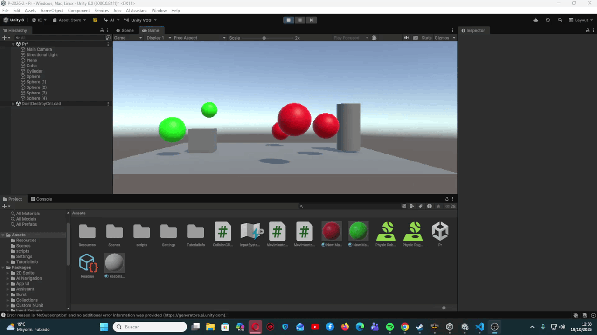
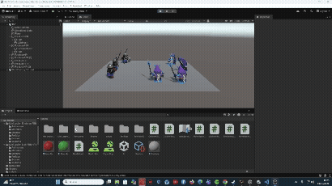
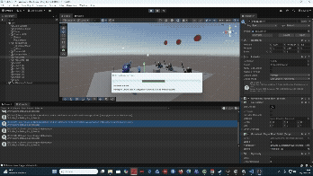
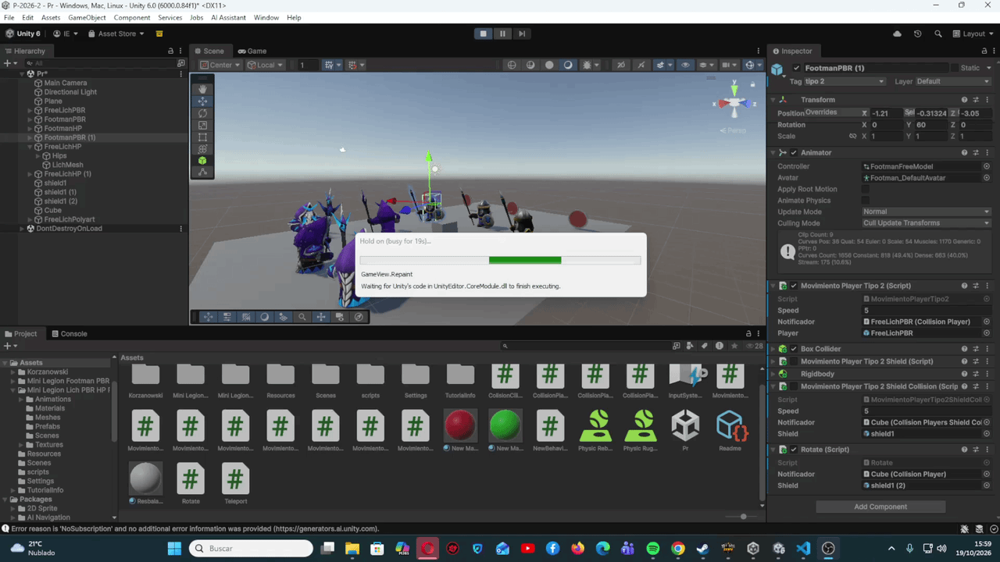
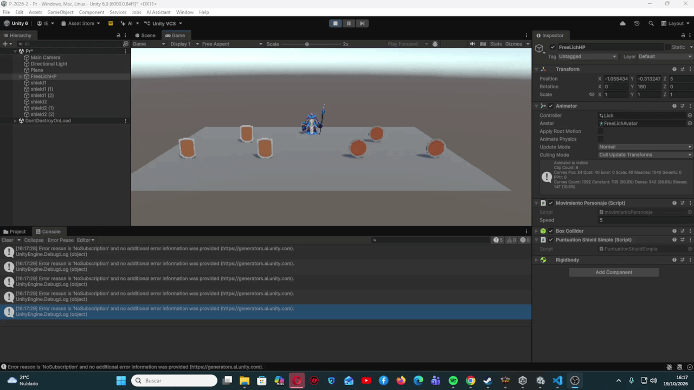
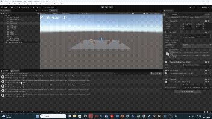
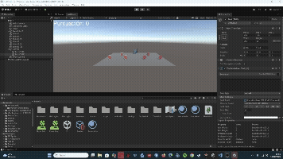
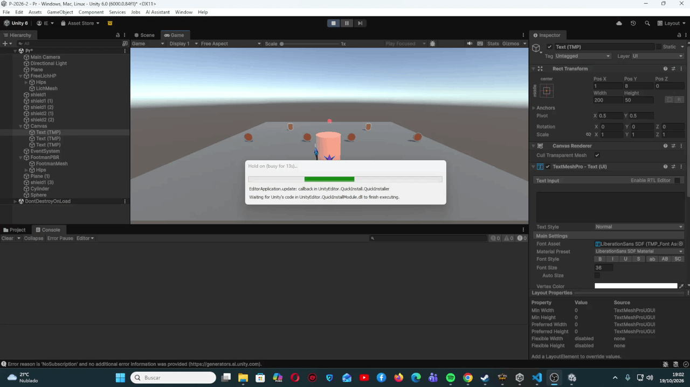
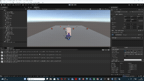
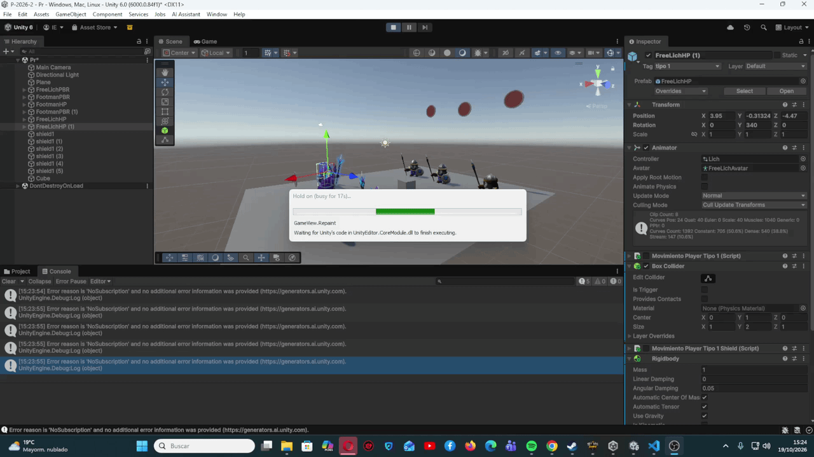

# Práctica 4 Eventos

## Ejercicio 1

Para el primer ejercicio se buscaba la utilización de eventos para que a través de la colisión entre el cubo y el cilindro, las diferentes esferas tanto las del tipo 1 (verdes), como del tipo 2 (rojas), se moviesen en las diferecciones a las que el enunciado había requerido.

Para ello dentro del fichero `ColisionCilindro.cs` nos encontramos como el cilindro al detectar la colisión envía un mensaje que desde los ficheros `MovimientoEsferaTipo1` y `MovimientoEsferaTipo2` se recogerá a través de un `notificador.EventoMovimiento += ActivarMovimiento;` y permitirá el movimiento de las diferentes esferas a su correspondiente objetivo.

## Ejercicio 2

En este seguindo ejercicio se nos pedía importar unn conjunto de assets los cuales incluía en ellos diferentes personajes los cuales deberiamos intercambiar por los objetos utilizados en el anterior ejercicio.

Una vez importados los colocabamos en el escenario y era necesario su creación de sui caja de colisiones debido a que no se generaba directamente con su creación en el escenario, por otro lado, en el ambito de los scripts se crearon dos nuevos pero que no modificaban nada de lo ya realizado en el anterior ejercicio.

## Ejercicio 3

En este ejercicio se pedía subir un poco la dificultad haciendo que una vez el cubo colisionase con un personaje de un tipo o de otro todos los personajes de ese mismo tipo deberían ir a un escudo que cada uno tendría seleccionado. Para ello utilizamos también al cubo como objeto el cual al detectar una colisión, en este caso a través de un `OnTriggerEnter()` envie un mensaje para activar un evento a todos aquellos personajes del mismo tipo del personaje con el cual el cubo colisionó.

Además, de eso para acabar con el enunciado del ejercicio se pedía que al llegar los personajes al objetivo (escudo) este casmbiase de color cosa que se realizó en el mismo script del movimiento de los jugadores.

## Ejercicio 4

En este ejercicio al igual que en el primer ejercicio se nos pide realizar un evento que suceda cuando el cubo colisione con un objeto de referencia que en este caso decidí que fuese un personaje del tipo 2. Cuando esto sucedía, todos los personajes de ese mismo tipo se teletransportaban a la zona donde estaban situados diferentes escudos (cada personajes a un escudo distinto), y por otro lado, los personajes del otro tipo al lanzar el mensaje del evento rotaban a ver cada uno a uno de los escudos.

## Ejercicio 5

En este quinto ejercicio se crearon dos tipo de escudos unos tipo 1 y otros tipo 2, todos ellos triggers, una vez llamada la función `OnTriggerEnter()` miraba se el escudo con el que se colisionaba nuestro personaje era de tipo 1 o de tipo 2 y según fuese, mostraba por pantalla la suma de sus puntos y eliminaba el escudo utilizando para ello la función `Destroy(other.gameObject)`.

## Ejercicio 6

Para este ejercicio se pedía algo similar al ejercicio anterior sin embargo, la puntuación no debería verse en la consola, deberia verse en la pantalla de la escena para ello, en la posición del Hierarchy de la interzar delk proyecto de Unity utilizando el botón derecho del ratón y dandole a UI y a Canvas creas un objeto Canvas al cual se le puede añadir texto, utilizando para eso el TextMeshPro y poniendo el texto que creas conveniente.

Una vez creado el Canvas, en el script que se utilizó en el anterior ejercicio se modificó para que en vez de mostrarlo solo en consola este se viese reflejado en la pantalla de la escena utilizando una variable `public TMP_Text textoPuntuacion;` y utilizandola a través de `textoPuntuacion.text = "Puntuación: " + score;`.

## Ejercicio 7

Para este ejercicio se pedía añadir al ejercicio anterior un nuevo marco de texto dentro del Canvas el cual comienza sin ningún texto, pero cada vez que se sobrepasen 100 puntos en ese lugar del Canvas apareciese un mensaje de recompensa.

## Ejercicio 8

En este ejercicio se nos pedia crear un escenario con todo lo realizado durante esta práctica, para ello comenzamos utilizando un personaje al que nosotros movemos el cual una vez entre dentro de un cilindro, con un `OnTriggerEnter()` teletrasporte a otro personaje hacia un circulo puesto al otro lado del plano de la escena, utilizando para ello un evento.

Este personaje que aparece tiene un nivel de poder y seguirá a nuestro personaje por el plano, para que nuestro personaje gane tiene que recojer todos los escudos del plano hasta tener el nivel de poder suficiente como para ganar al enemigo, todo ello utilizando `OnTriggerEnter()` para recojer los escudos y la suma de puntos realizada como en los ejercicios anteriores y mostrandola por pantalla.

Una vez los dos personajes colisionen se mirará cual tiene un mayor nivel de poder y ese será el ganador mostrandolo por pantalla.

## Ejercicio 9

En este ejercicio se pedía replicar en la ejecución del ejercicio 3 pero en este caso haciendo que el cubo en este caso sea físico, cambiando este a Rigidbody y cambiando los `OnTriggerEnter()` a `OnCollisionERnter()`.

